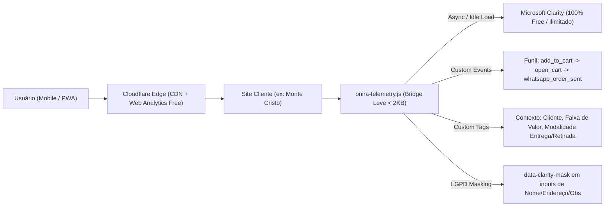

# Plano de Arquitetura: Camada de Observabilidade Zero-Cost (Microsoft Clarity + Cloudflare)

## 1. Overview (O Quê & Por Quê)
Criar uma camada padronizada de **Observabilidade, Comportamento do Usuário e Conversão (CRO)** para os clientes da **Onira Labs** (incluindo [Monte Cristo Bebidas](file:///c:/Users/ADM/onira-labs/clientes/monte-cristo/index.html) e demais projetos em `clientes/<slug>`), hospedados no **Cloudflare Pages** com DNS na Cloudflare.

**Objetivo Principal:** Custo operacional **R$ 0,00 (100% Free Tier)**, impacto zero na nota de performance (Core Web Vitals / Lighthouse), conformidade total com a LGPD e rastreabilidade completa do funil de vendas (Vitrine → Carrinho → Disparo do Pedido no WhatsApp).

---

## 2. Project Type
- **Tipo:** `WEB` (Static / PWA Single-Page Catalogs + Cloudflare Pages / Edge)
- **Agentes Envolvidos:**
  - `project-planner` (Planejamento e Arquitetura)
  - `frontend-specialist` (Instrumentação de Eventos Customizados, LGPD Masking e Telemetria de Funil)
  - `devops-engineer` (Configuração Cloudflare Pages, Zaraz / Web Analytics / Edge Middleware)
  - `seo-specialist` & `performance-optimizer` (Garantia de Zero Impacto em LCP/INP/CLS)

---

## 3. Arquitetura Zero-Cost (100% Gratuita)



### Pilares da Stack Sem Custo (R$ 0,00/mês)

| Camada | Ferramenta | Limite Gratuito | Função na Onira Labs |
| :--- | :--- | :--- | :--- |
| **Comportamento & Visual** | **Microsoft Clarity** | **Ilimitado** (100% grátis, sem teto de sessões) | Gravação de tela real, mapas de calor (clique/scroll), *rage clicks*, *dead clicks* e funis de conversão. |
| **Telemetria de Funil** | **Clarity Custom Events & Tags API** | **Ilimitado** | Rastrear cliques em "Adicionar", abertura de gaveta, modal de consignação e envio para WhatsApp. |
| **Performance & Tráfego** | **Cloudflare Web Analytics** | **Ilimitado** no Cloudflare Pages | Core Web Vitals reais (LCP, INP, CLS), origem de tráfego e países/regiões sem usar cookies. |
| **Injeção & Gestão** | **Snippet Padronizado (`onira-telemetry.js`) ou Cloudflare Zaraz** | **100% Grátis** (Zaraz Free = 1M eventos/mês) | Carregamento assíncrono em `requestIdleCallback` (zero bloqueio de renderização) e isolamento para devs (`?onira_internal=1`). |
| **Relatório Executivo** | **Clarity Data Export API + GitHub Actions / Worker** | **Grátis** (até 10 req/dia por projeto na API do Clarity) | Extração de indicadores mensais para comprovar ROI aos clientes da Onira Labs. |

---

## 4. Eventos e Tags Customizadas do Funil Onira (`onira-telemetry.js`)

O Microsoft Clarity básico mostra apenas páginas vistas e cliques genéricos. Como os catálogos da Onira Labs são **SPAs/PWAs em página única** com checkout via WhatsApp, nossa camada de observabilidade vai instrumentar automaticamente:

### A. Custom Events (`clarity("event", "...")`)
1. `product_add_to_cart` — Quando o cliente adiciona um item na vitrine.
2. `cart_drawer_open` — Quando o cliente abre a gaveta do pedido ("Ver Pedido").
3. `consignacao_modal_open` — Quando o cliente abre a modal de Consignação 20% (exclusivo Monte Cristo / eventos).
4. `consignacao_whatsapp_click` — Quando clica em tirar dúvidas da consignação no WhatsApp.
5. `whatsapp_order_sent` — **Conversão Ouro (Macro-Conversão):** Clique em `#btn-send-whatsapp` (`window.sendWhatsAppOrder()`).
6. `whatsapp_direct_click` — Clique nos links diretos de WhatsApp do topo ou rodapé (`#top-bar-wa-link`, `#footer-wa-link`).
7. `pwa_installed` — Quando o cliente instala o app PWA na tela inicial.

### B. Custom Session Tags (`clarity("set", "chave", "valor")`)
Permitem filtrar gravações de vídeo no painel do Clarity (ex: *"Quero assistir apenas sessões que adicionaram mais de R$ 500 no carrinho mas NÃO enviaram no WhatsApp"*):
- `client_slug`: `"monte-cristo"`
- `page_type`: `"catalogo"` | `"proposta"`
- `cart_tier`: `"empty"` | `"ate_200"` | `"200_a_500"` | `"acima_500"` (faixas de valor sem expor dados sensíveis)
- `delivery_type`: `"entrega"` | `"retirada"`
- `has_converted`: `"true"` (quando dispara o pedido no WhatsApp)

### C. Privacidade, LGPD e Filtro de Tráfego Interno
- **LGPD Masking:** Aplicação de `data-clarity-mask="true"` nos inputs do carrinho (nome do cliente, endereço de entrega, observações, telefone) para que nenhum dado pessoal seja gravado nos vídeos.
- **Bypass de Equipe Onira Labs:** Se o acesso tiver `?notrack=1` na URL ou `localStorage.getItem('onira_ignore_analytics') === 'true'`, o Clarity não é inicializado, evitando sujar as métricas do cliente durante testes e manutenção.

---

## 5. Success Criteria (Critérios de Sucesso)
- [ ] **Custo R$ 0,00:** Nenhuma dependência de planos pagos da Cloudflare, Google Tag Manager Server-Side pago ou ferramentas de heatmap pagas (Hotjar/FullStory).
- [ ] **Zero Degradação de Performance:** Script do Clarity carregado após o carregamento visual (`window. load` / `requestIdleCallback`), mantendo o Splash PWA e o TBT/INP intactos.
- [ ] **Rastreamento de Abandono de Carrinho:** Capacidade de filtrar no painel do Clarity todas as sessões com `cart_drawer_open` SEM `whatsapp_order_sent`.
- [ ] **Conformidade LGPD:** Nenhum texto digitado pelo comprador em campos de endereço/nome visível nas gravações.
- [ ] **Replicabilidade Multi-Cliente:** Arquitetura plug-and-play para qualquer cliente em `clientes/<slug>/`.

---

## 6. File Structure (Estrutura de Arquivos Planejada)

```text
clientes/
└── monte-cristo/ (Piloto — replicável para todos os clientes)
    ├── index.html                        # Inclusão de data-clarity-mask nos inputs sensíveis + tag telemetry.js
    ├── telemetry.js                      # Camada de Observabilidade Onira (Clarity Loader + Hooks de Funil + LGPD)
    ├── sw.js                             # Bypass explícito de domínios *.clarity.ms no Service Worker (nunca cachear analytics!)
    └── observabilidade-clarity-cloudflare.md  # Este documento de planejamento

.agents/
└── memory/
    └── rotina-proposta-deploy.md         # Atualização do checklist pós-deploy com ativação do Clarity + Cloudflare Web Analytics
```

> [!IMPORTANT]
> **Atenção Crítica para PWAs (`sw.js`):** Nos projetos Onira Labs com Service Worker (como o [sw.js](file:///c:/Users/ADM/onira-labs/clientes/monte-cristo/sw.js) do Monte Cristo), requisições para `www.clarity.ms` e `*.clarity.ms` **NUNCA** devem ser interceptadas por estratégias *Cache-First*, caso contrário as gravações de sessão falham silenciosamente. A Task 2 garante esse bypass no Service Worker.

---

## 7. Task Breakdown (Plano de Execução)

### Task 1: Criar o Módulo Padronizado `telemetry.js` (Zero-Blocking + Funil Onira)
- **Agent:** `frontend-specialist` | **Skill:** `clean-code`, `nextjs-react-expert` (Web Perf)
- **Priority:** P0 | **Dependencies:** Nenhuma
- **INPUT:** Estrutura atual de eventos do [index.html](file:///c:/Users/ADM/onira-labs/clientes/monte-cristo/index.html) e [app.js](file:///c:/Users/ADM/onira-labs/clientes/monte-cristo/app.js) (`sendWhatsAppOrder`, `openCart`, `openConsignacaoModal`).
- **OUTPUT:** Arquivo `clientes/monte-cristo/telemetry.js` com:
  1. Inicialização preguiçosa (`requestIdleCallback` / pós-splash) do Microsoft Clarity.
  2. Suporte a `?notrack=1` para ignorar acessos da equipe Onira Labs.
  3. Listeners não-intrusivos (sem quebrar `app.js`) para eventos de carrinho, modal de consignação e disparo de WhatsApp.
- **VERIFY:** No DevTools Console, executar `window.OniraTelemetry.debug()` e verificar os disparos simulados de tags e eventos.
- **Rollback:** Remover a referência ao `telemetry.js`.

### Task 2: Blindar o Service Worker (`sw.js`) para Tráfego de Observabilidade
- **Agent:** `frontend-specialist` | **Skill:** `clean-code`
- **Priority:** P0 | **Dependencies:** Task 1
- **INPUT:** Arquivo [sw.js](file:///c:/Users/ADM/onira-labs/clientes/monte-cristo/sw.js) atual do cliente.
- **OUTPUT:** Regra de *Network-Only / Bypass* no `fetch` listener do `sw.js` para ignorar URLs externas de telemetria (`clarity.ms`, `cloudflareinsights.com`).
- **VERIFY:** Inspecionar aba Network com Service Worker ativo e confirmar que os POSTs para `*.clarity.ms/collect` retornam `200/204` diretamente da rede.
- **Rollback:** Reverter edição no `sw.js`.

### Task 3: Instrumentação LGPD (`data-clarity-mask`) e Integração no `index.html`
- **Agent:** `frontend-specialist` | **Skill:** `ui-responsive-qa`, `web-design-guidelines`
- **Priority:** P1 | **Dependencies:** Task 1, Task 2
- **INPUT:** Formulário de identificação/entrega na gaveta do carrinho em [index.html](file:///c:/Users/ADM/onira-labs/clientes/monte-cristo/index.html).
- **OUTPUT:** Atributos `data-clarity-mask="true"` adicionados aos campos de dados pessoais do cliente e inclusão do `<script src="telemetry.js" defer></script>`.
- **VERIFY:** Verificar no DOM que todos os `<input>` e `<textarea>` de dados do comprador possuem `data-clarity-mask="true"`.
- **Rollback:** Reverter atributos no `index.html`.

### Task 4: Guia Operacional Multi-Tenant (Cloudflare + Clarity Projetos & Etiquetas)
- **Agent:** `devops-engineer` | **Skill:** `deployment-procedures`, `documentation-templates`
- **Priority:** P2 | **Dependencies:** Task 3
- **INPUT:** Rotina operacional de deploy da Onira Labs ([rotina-proposta-deploy.md](file:///c:/Users/ADM/onira-labs/.agents/memory/rotina-proposta-deploy.md)).
- **OUTPUT:** Padronização do setup no painel do Clarity (1 Projeto por Cliente sob a conta mestre da Onira Labs + Smart Events configurados) e ativação do Cloudflare Web Analytics / Zaraz quando aplicável.
- **VERIFY:** Checklist documentado e validado na memória operacional.
- **Rollback:** N/A (documentação).

---

## 8. Phase X: Verification Checklist (Definição de Pronto)
- [ ] **Security & LGPD Scan:** Nenhum PII (telefone, endereço, nome) capturado em texto claro nas tags do Clarity (`security_scan.py`).
- [ ] **Service Worker Bypass:** Chamadas para `clarity.ms` e `cloudflareinsights.com` passam fora do cache do PWA.
- [ ] **Performance Check:** Carregamento do Clarity ocorre apenas após o First Contentful Paint / Splash PWA, sem travar a thread principal.
- [ ] **Teste de Funil Completo:** Adicionar produto → Abrir carrinho → Clicar em Enviar WhatsApp registra os eventos `product_add_to_cart`, `cart_drawer_open` e `whatsapp_order_sent`.

